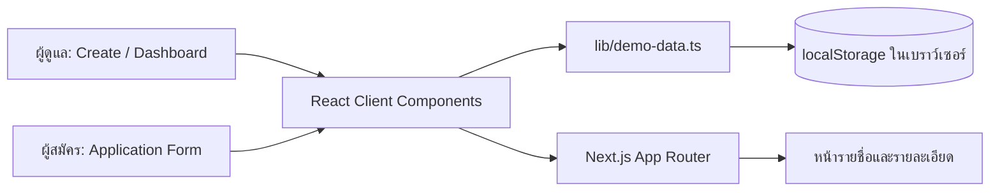

# งานของกานต์: System flow และ integration สำหรับเดโม

วันที่ตรวจล่าสุด: 1 พฤศจิกายน 2569 · branch `kan/backend`

## ขอบเขตที่ทำ

- หน้าสร้างรอบรับสมัครบันทึกชื่อ คณะ ปี วันปิดรับ และ requirement; สร้างลิงก์จาก origin ที่เปิดเว็บอยู่ ไม่ผูกกับ `localhost`.
- หน้าใบสมัครตรวจข้อมูลบังคับ รูปแบบอีเมล โทรศัพท์ GPAX และไฟล์ PDF ไม่เกิน 50 MB แล้วเพิ่มผู้สมัครในข้อมูลเดโม.
- หน้ารายชื่อและรายละเอียดใช้ข้อมูลผู้สมัครชุดเดียวกัน; เปิดรายละเอียดตาม id จริง; Approve/Reject เปลี่ยนสถานะในรายชื่อและ dashboard.
- Dashboard คำนวณจำนวนผู้สมัคร รอตรวจ อนุมัติ และคะแนนเฉลี่ยจากข้อมูลเดียวกัน.
- ผู้สมัครตัวอย่างมีคะแนน mock เท่านั้น ผู้สมัครใหม่แสดง “รอการประเมิน” เพื่อไม่อ้างว่าระบบ AI วิเคราะห์ไฟล์แล้ว.

## User flow สำหรับนำเสนอ

1. เปิด `/create` กรอกข้อมูลรอบรับสมัคร แล้วกด “บันทึกและสร้างลิงก์”.
2. คัดลอกลิงก์หรือกดเปิดหน้าผู้สมัคร `/apply/ux-ai-2026`.
3. กรอกข้อมูล แนบ PDF และส่งใบสมัคร; จดหมายเลขอ้างอิง.
4. เปิด `/applications` เห็นรายชื่อใหม่ แล้วกดเปิดรายละเอียด.
5. กด Approve หรือ Reject; กลับหน้ารายชื่อและ `/dashboard` เพื่อตรวจสถานะและยอดรวม.
6. เปิดผู้สมัครตัวอย่าง `pimchanok` เพื่ออธิบายคะแนน mock และข้อจำกัดของ AI.

## Architecture



Next.js ใช้ App Router สำหรับหน้าและเส้นทาง, React Client Components จัดการ form/interaction, TypeScript กำหนดโครงสร้าง `Campaign` และ `Applicant`. `lib/use-demo-data.ts` รับการเปลี่ยนข้อมูลและทำให้หน้าที่เปิดในแท็บเดียวกันหรือแท็บอื่นบน origin เดียวกันรีเฟรชข้อมูล. CSS เดิมกำหนดหน้าตาและ responsive.

## ข้อจำกัดที่ต้องอธิบายในการนำเสนอ

- เป็น **เดโมฝั่งเบราว์เซอร์** ไม่มี database, authentication, API อัปโหลด หรือบริการอีเมล. การแชร์ URL ไปคนละเครื่องจะเปิดหน้าฟอร์มได้ แต่ข้อมูลรอบรับสมัครและใบสมัครที่สร้างไว้จะไม่ตามไปด้วย.
- ระบบบันทึกเพียงชื่อไฟล์ PDF และข้อมูลที่กรอก ไม่บันทึกเนื้อไฟล์ จึงไม่สามารถดาวน์โหลดหรือเปิด Portfolio ต้นฉบับภายหลัง.
- คะแนนของผู้สมัครตัวอย่างเป็นข้อมูล mock ที่กำหนดไว้ล่วงหน้า ไม่มีการเรียกโมเดล AI. ผู้สมัครใหม่ไม่มีคะแนน.
- วันที่ปิดรับสมัครเป็นข้อความสำหรับสาธิต ยังไม่ได้ใช้ปิดแบบฟอร์มอัตโนมัติ.
- ข้อมูลอยู่ใน localStorage ของ origin เดียวกัน; ล้างข้อมูลเว็บไซต์แล้วข้อมูลที่ส่งใหม่จะหาย.

## การรัน

```bash
npm install
npm run dev
```

เปิด `http://localhost:3000/dashboard` แล้วทำ flow ด้านบน. สำหรับตรวจ production ใช้ `npm run typecheck` และ `npm run build`.

## ผลตรวจ

| รายการ | ผล | หลักฐาน |
|---|---|---|
| TypeScript | Pass | `npm run typecheck` exit 0 |
| Production build | Pass | `npm run build` สร้างทุก route สำเร็จ |
| สร้างลิงก์ | Pass | เปิด `/create` แล้วกดสร้างลิงก์ในเบราว์เซอร์ เห็นหน้าผลลัพธ์และลิงก์เปิดฟอร์ม |
| ตรวจฟอร์มที่ไม่มีไฟล์ | Pass | กรอกข้อมูลและกดส่งโดยไม่แนบไฟล์ เห็นข้อความ `กรุณาแนบ Portfolio PDF` และไม่สร้างใบสมัคร |
| Approve และ dashboard | Pass | เปิด `pimchanok`, กด Approve, เปิด dashboard พบอนุมัติ 1 คนและรอตรวจ 3 คน |
| ส่งพร้อมไฟล์ PDF | Pass หลัง merge | อัปโหลดไฟล์ PDF ทดสอบผ่านเบราว์เซอร์, กรอกข้อมูลครบ, ส่งสำเร็จ, รีเฟรชแล้วยังเห็นหน้าสำเร็จ และพบผู้สมัครใหม่ใน `/applications` |
| ไฟล์ผิดชนิด/เกิน 50 MB | Pass | Chrome ปฏิเสธ `.txt` และ PDF 51 MiB โดยไม่เพิ่มผู้สมัคร |
| Approve/Reject หลังรีเฟรช | Pass | สถานะคงอยู่ในรายละเอียด, Applicants และ Dashboard ตรงกัน |
| มือถือ 390×844 | Pass เฉพาะป้ายสถานะ | แก้ CSS ให้ Applicants และ Dashboard แสดง Approved/Rejected; ยังต้องตรวจทุกส่วนพร้อมภาพหลักฐานจากตง |

รายละเอียดการทดสอบรอบล่าสุดอยู่ที่ `assign/workflow/kan-system-flow-test-2026-11-01.md`.

## จุดส่งต่อ

ให้นัทนำ diagram, เทคโนโลยี, flow และข้อจำกัดไปใช้ในรายงาน. ให้ตงทดสอบจริงบนเดสก์ท็อปและมือถือ รวมถึง flow ส่งใบสมัครและเปลี่ยนสถานะ แล้วบันทึก screenshot/ผล Pass-Fail. หากต้องการใช้งานจริง ขั้นถัดไปคือออกแบบ backend, database, file storage, สิทธิ์ผู้ใช้ และระบบวิเคราะห์ AI ที่ตรวจสอบผลได้.
