# บันทึกผล Retest PortfolioMatch

## TC-01 สร้างรอบรับสมัครและตรวจข้อมูลในลิงก์สมัคร

| รายการ | บันทึก |
|---|---|
| ผล | Pass |
| วันที่และเวลา | [01/11/2026 test-time = 16:28] |
| ผู้ทดสอบ | ตง |
| Branch / Commit | `kan/backend` / commit : aa8c72765bf9e303bc92428416e0757a59fc5753 |
| Browser / Version | Google Chrome / Version 156.0.8078.48 (Official Build) (64-bit) |
| Viewport |  1766 × 1205 CSS px |
| หน้าที่ทดสอบ | `/create` และลิงก์สมัครที่สร้างจากรอบนี้ |
| PDF ทดสอบ | N/A |

### ข้อมูลทดสอบ

- ชื่อรอบรับสมัคร: รอบ Portfolio – สาขาวิศวกรรมคอมพิวเตอร์
- วันปิดรับสมัคร: 30 พฤศจิกายน 2569
- Requirement: มีผลงานการแข่งขันวิชาการคอมพิวเตอร์ที่โดดเด่น มีความสามารถในการแก้ไขปัญหาเฉพาะหน้า มีพิ้นฐานทางคอมพิวเตอร์และการโปรแกรม
- ลิงก์สมัครที่สร้าง: [http://localhost:3000/apply/ux-ai-2026?title=%E0%B8%A3%E0%B8%AD%E0%B8%9A+Portfolio+%E2%80%93+%E0%B8%AA%E0%B8%B2%E0%B8%82%E0%B8%B2%E0%B8%A7%E0%B8%B4%E0%B8%A8%E0%B8%A7%E0%B8%81%E0%B8%A3%E0%B8%A3%E0%B8%A1%E0%B8%84%E0%B8%AD%E0%B8%A1%E0%B8%9E%E0%B8%B4%E0%B8%A7%E0%B9%80%E0%B8%95%E0%B8%AD%E0%B8%A3%E0%B9%8C&year=2569&program=%E0%B8%84%E0%B8%93%E0%B8%B0%E0%B8%A7%E0%B8%B4%E0%B8%A8%E0%B8%A7%E0%B8%81%E0%B8%A3%E0%B8%A3%E0%B8%A1%E0%B8%A8%E0%B8%B2%E0%B8%AA%E0%B8%95%E0%B8%A3%E0%B9%8C-%E0%B8%A7%E0%B8%B4%E0%B8%A8%E0%B8%A7%E0%B8%81%E0%B8%A3%E0%B8%A3%E0%B8%A1%E0%B8%84%E0%B8%AD%E0%B8%A1%E0%B8%9E%E0%B8%B4%E0%B8%A7%E0%B9%80%E0%B8%95%E0%B8%AD%E0%B8%A3%E0%B9%8C&openDate=2026-11-15&deadline=30+%E0%B8%9E%E0%B8%A4%E0%B8%A8%E0%B8%88%E0%B8%B4%E0%B8%81%E0%B8%B2%E0%B8%A2%E0%B8%99+2569&requirements=%E0%B8%A1%E0%B8%B5%E0%B8%9C%E0%B8%A5%E0%B8%87%E0%B8%B2%E0%B8%99%E0%B8%81%E0%B8%B2%E0%B8%A3%E0%B9%81%E0%B8%82%E0%B9%88%E0%B8%87%E0%B8%82%E0%B8%B1%E0%B8%99%E0%B8%A7%E0%B8%B4%E0%B8%8A%E0%B8%B2%E0%B8%81%E0%B8%B2%E0%B8%A3%E0%B8%84%E0%B8%AD%E0%B8%A1%E0%B8%9E%E0%B8%B4%E0%B8%A7%E0%B9%80%E0%B8%95%E0%B8%AD%E0%B8%A3%E0%B9%8C%E0%B8%97%E0%B8%B5%E0%B9%88%E0%B9%82%E0%B8%94%E0%B8%94%E0%B9%80%E0%B8%94%E0%B9%88%E0%B8%99+%E0%B8%A1%E0%B8%B5%E0%B8%84%E0%B8%A7%E0%B8%B2%E0%B8%A1%E0%B8%AA%E0%B8%B2%E0%B8%A1%E0%B8%B2%E0%B8%A3%E0%B8%96%E0%B9%83%E0%B8%99%E0%B8%81%E0%B8%B2%E0%B8%A3%E0%B9%81%E0%B8%81%E0%B9%89%E0%B9%84%E0%B8%82%E0%B8%9B%E0%B8%B1%E0%B8%8D%E0%B8%AB%E0%B8%B2%E0%B9%80%E0%B8%89%E0%B8%9E%E0%B8%B2%E0%B8%B0%E0%B8%AB%E0%B8%99%E0%B9%89%E0%B8%B2+%E0%B8%A1%E0%B8%B5%E0%B8%9E%E0%B8%B4%E0%B9%89%E0%B8%99%E0%B8%90%E0%B8%B2%E0%B8%99%E0%B8%97%E0%B8%B2%E0%B8%87%E0%B8%84%E0%B8%AD%E0%B8%A1%E0%B8%9E%E0%B8%B4%E0%B8%A7%E0%B9%80%E0%B8%95%E0%B8%AD%E0%B8%A3%E0%B9%8C%E0%B9%81%E0%B8%A5%E0%B8%B0%E0%B8%81%E0%B8%B2%E0%B8%A3%E0%B9%82%E0%B8%9B%E0%B8%A3%E0%B9%81%E0%B8%81%E0%B8%A3%E0%B8%A1]

### ขั้นตอนทำซ้ำ

1. เปิด `http://localhost:3000/create` ใน Chrome ที่ใช้ทดสอบรอบนี้
2. กรอกชื่อรอบ วันปิดรับสมัคร และ requirement ตามข้อมูลทดสอบด้านบน
3. สร้างหรือบันทึกรอบรับสมัคร แล้วคัดลอกลิงก์สมัครที่ระบบแสดง
4. เปิดลิงก์นั้นในแท็บใหม่ของ Chrome โปรไฟล์เดิม
5. เทียบชื่อรอบ วันปิดรับสมัคร และ requirement บนฟอร์มกับค่าที่กรอกในหน้า `/create`
6. รีเฟรชหน้าฟอร์มหนึ่งครั้ง แล้วตรวจว่าข้อมูลรอบยังตรงกัน

### ผลที่คาดหวัง

ฟอร์มสมัครเปิดได้ และแสดงชื่อรอบ วันปิดรับสมัคร และ requirement ตรงกับค่าที่บันทึกไว้ในหน้า `/create` ทั้งก่อนและหลังรีเฟรช

### ผลที่พบจริง

หลังจากกรอกข้อมูลตั้งชื่อรอบใหม่ กำหนดวันที่ปิดและเปิดรับสมัครและ requirement ใหม่ หลังจากทำการสร้างลิงก์ application form พบว่ามีข้อมูลและรายเอียดตรงกับข้อมูลที่กรอกในหน้า `/create` ทุกประการ

### หลักฐาน

- Screenshot หน้า `/create` หลังกรอกข้อมูล: 

-Screenshot หน้า ` /create` หลังสร้างลิงก์: 

- Screenshot ฟอร์มสมัครที่เปิดจากลิงก์: 
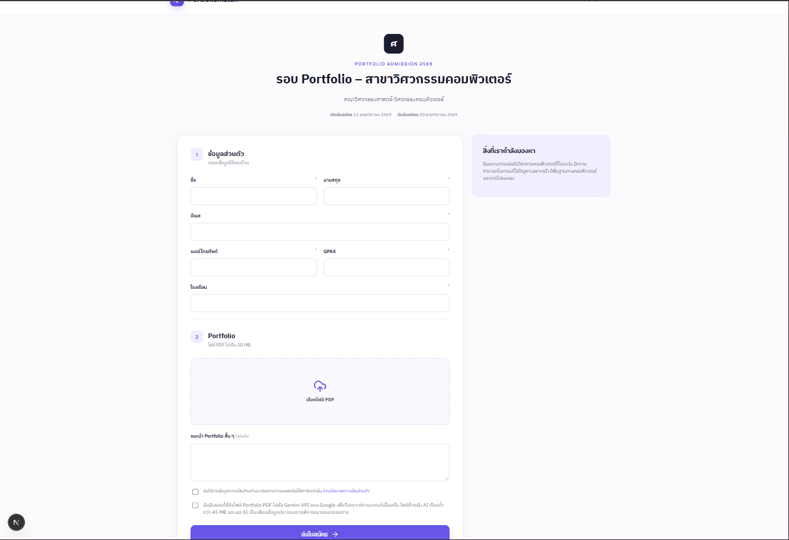
- Screenshot ฟอร์มสมัครหลังรีเฟรช: 
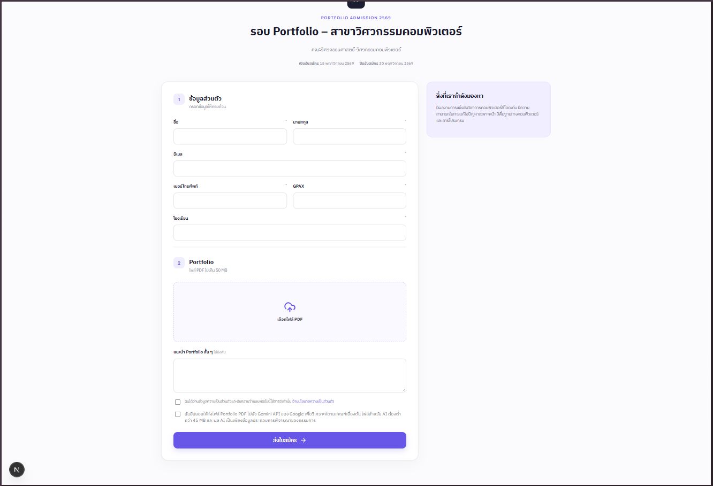

### Issue และความรุนแรง

[ไม่มี / ระบุปัญหา ขั้นตอนที่เกิด และระดับความรุนแรง]

---

## TC-02 ช่องบังคับของฟอร์ม

| รายการ | บันทึก |
|---|---|
| ผล | Pass |
| วันที่และเวลา | 01/11/2026 เวลา [17:29] |
| ผู้ทดสอบ | ตง |
| Branch / Commit | `kan/backend` / `aa8c72765bf9e303bc92428416e0757a59fc5753` |
| Browser / Version | Google Chrome / 156.0.8078.48 (Official Build) (64-bit) |
| Viewport | 1766 × 1205 CSS px (desktop) |
| หน้าที่ทดสอบ | ฟอร์มสมัครจาก TC-01 |
| PDF ทดสอบ | N/A |

### ข้อมูลทดสอบ

- ฟอร์มว่าง แล้วทดลองเว้นช่องบังคับทีละช่องโดยกรอกช่องอื่นให้ครบ

### ขั้นตอนทำซ้ำ

1. เปิดฟอร์ม
2. กดส่งขณะฟอร์มว่าง
3. กรอกข้อมูลให้ครบยกเว้นช่องบังคับหนึ่งช่องแล้วกดส่ง
4. ทำซ้ำกับช่องบังคับอื่น
5. ตรวจ `/applications`

### ผลที่คาดหวัง

ฟอร์มแจ้งช่องที่ต้องกรอก ไม่ขึ้นหน้าสำเร็จ และไม่มีผู้สมัครใหม่

### ผลที่พบจริง

หากทำการเว้นช่องกรอกข้อมูลไว้จะไม่สามารถส่งใบสมัครได้ จำเป็นต้องให้ผู้สมัครกรอกข้อมูลให้ครบทุกช่องเสียก่อน และหลังจากกดใบสมัครที่ข้อมูลไม่ครบ ส่วนของ Applicant ไม่ได้มีการเพิ่มข้อมูลผู้สมัครใหม่ 

### หลักฐาน
- Screenshot ส่งใบสมัครเปล่า:
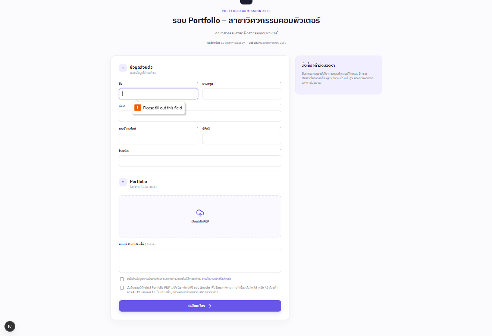
- Screenshot เว้นช่องชื่อ/สกุล:
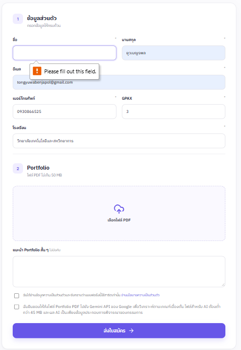
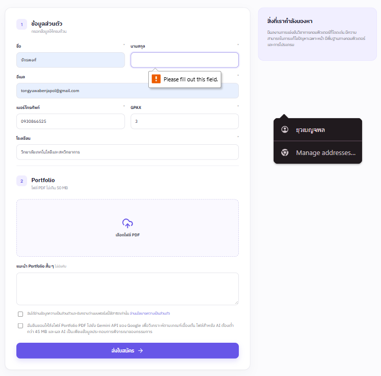
- Screenshot เว้นช่องอีเมล:
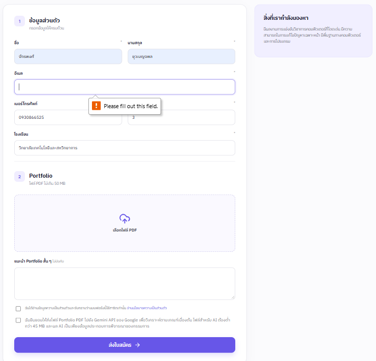
- Screenshot เว้นช่องเบอร์โทรศัพท์:
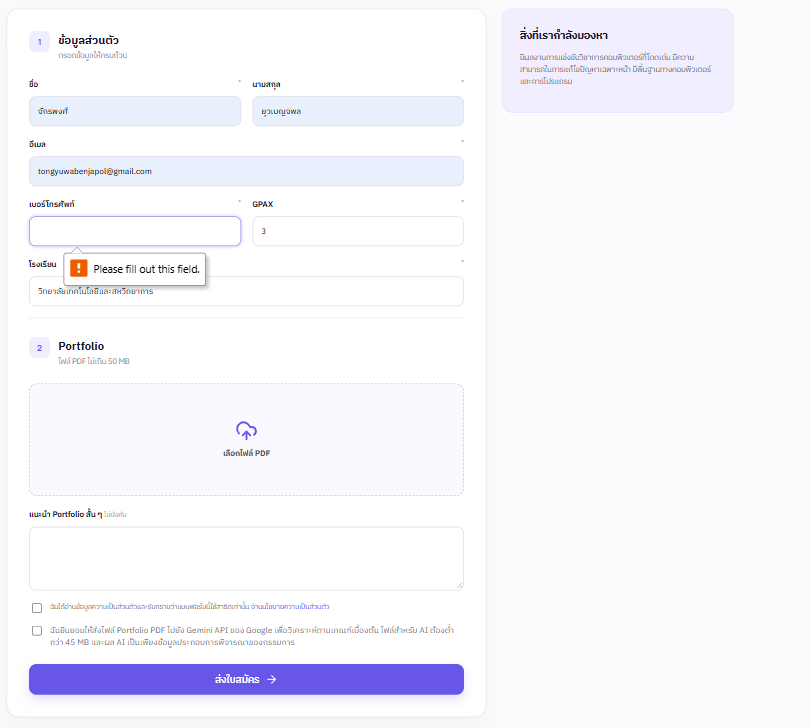
- Screenshot เว้นช่องGPAX:
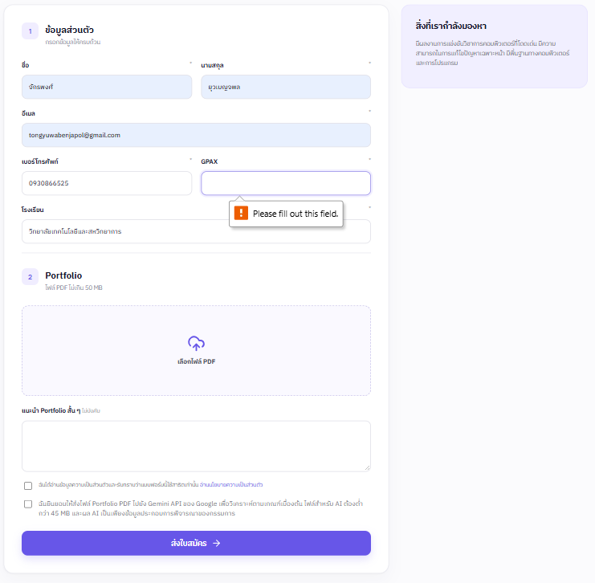
- Screenshot เว้นช่องโรงเรียน:
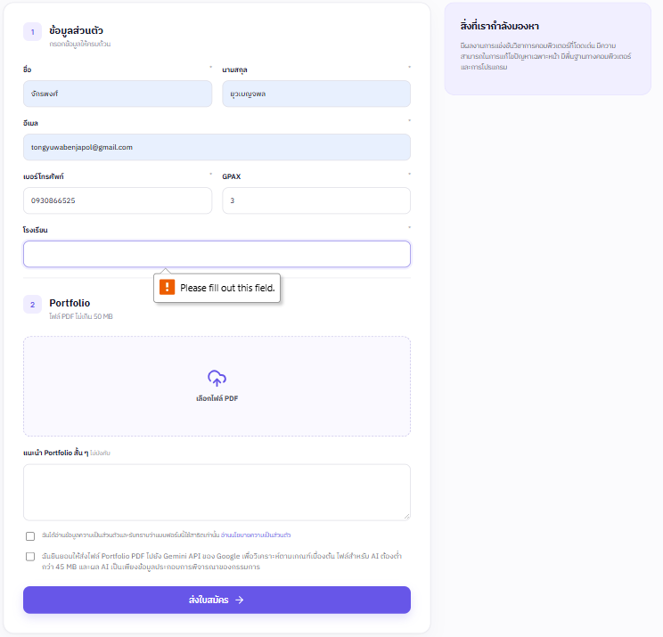

### Issue และความรุนแรง

[ไม่มี / รายละเอียด]

## TC-03 การยินยอมหลัก

| รายการ | บันทึก |
|---|---|
| ผล | Pass |
| วันที่และเวลา | 01/11/2026 เวลา [17:56] |
| ผู้ทดสอบ | ตง |
| Branch / Commit | `kan/backend` / `aa8c72765bf9e303bc92428416e0757a59fc5753` |
| Browser / Version | Google Chrome / 156.0.8078.48 (Official Build) (64-bit) |
| Viewport | 1766 × 1205 CSS px (desktop) |
| หน้าที่ทดสอบ | ฟอร์มสมัครจาก TC-01 |
| PDF ทดสอบ | [computer-engineering-portfolio-10-pages-normal-size.pdf] |

### ข้อมูลทดสอบ

- ข้อมูลทุกช่องถูกต้องและแนบ PDF แต่ไม่เลือกช่องยินยอมหลัก

### ขั้นตอนทำซ้ำ

1. กรอกข้อมูล
2. แนบ PDF
3. เว้นช่องยินยอมหลัก
4. กดส่ง
5. ตรวจ `/applications`

### ผลที่คาดหวัง

ส่งไม่ได้และไม่มีผู้สมัครใหม่

### ผลที่พบจริง

เมื่อทำการกรอกข้อมูลผู้สมัครครบถ้วน และทำการแนบ PDF file แต่ไม่ได้มีการยินยอมการให้ข้อมูลส่วนตัวตามนโยบายจะไม่สามารถส่งใบสมัครได้

### หลักฐาน

- Screenshots ไม่ให้ความยินยอมการให้ข้อมูลส่วนตัว
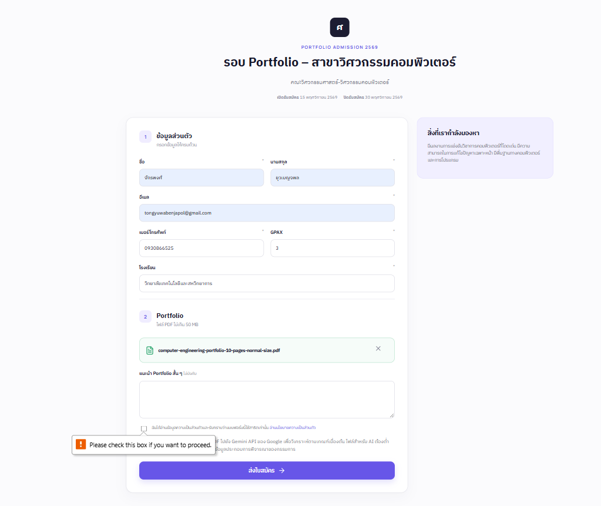

### Issue และความรุนแรง

[ไม่มี / รายละเอียด]

## TC-04 รูปแบบอีเมล

| รายการ | บันทึก |
|---|---|
| ผล | Pass |
| วันที่และเวลา | 01/11/2026 เวลา [18:03] |
| ผู้ทดสอบ | ตง |
| Branch / Commit | `kan/backend` / `aa8c72765bf9e303bc92428416e0757a59fc5753` |
| Browser / Version | Google Chrome / 156.0.8078.48 (Official Build) (64-bit) |
| Viewport | 1766 × 1205 CSS px (desktop) |
| หน้าที่ทดสอบ | ฟอร์มสมัครจาก TC-01 |
| PDF ทดสอบ | [computer-engineering-portfolio-10-pages-normal-size.pdf] |

### ข้อมูลทดสอบ

- ใช้อีเมลผิดรูปแบบ เช่น `not-an-email`; ช่องอื่นถูกต้อง

### ขั้นตอนทำซ้ำ

1. กรอกข้อมูลและแนบ PDF
2. ใส่อีเมลผิดรูปแบบ
3. เลือกการยินยอมหลัก
4. กดส่ง
5. ตรวจ `/applications`

### ผลที่คาดหวัง

แจ้งอีเมลไม่ถูกต้องและไม่มีผู้สมัครใหม่

### ผลที่พบจริง

พบว่าเมื่อทำการกรอกอีเมลในรูปแบบที่ไม่ถูกต้องระบบจะไม่อนุมัติให้ผู้สมัครส่งใบสมัครได้แม้จะมีการกรอกข้อมูลช่องอื่นครบ มีการแนบ PDF file และมีการยินยอมการให้ข้อมูล

### หลักฐาน
-Screenshots กรอกอีเมลผิดรูปแบบ
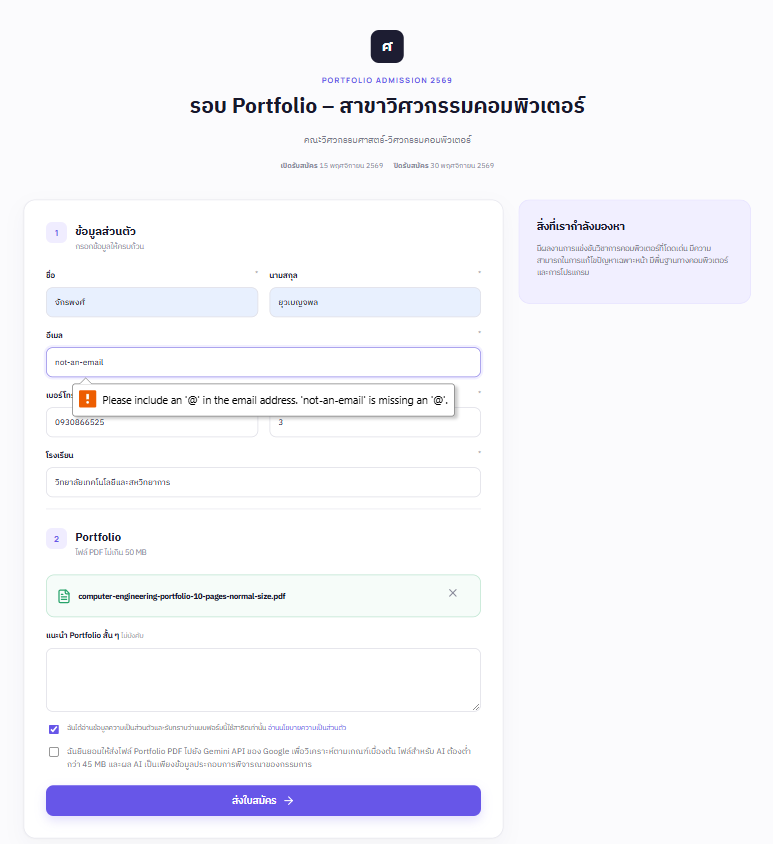

### Issue และความรุนแรง

[ไม่มี / รายละเอียด]

## TC-05 รูปแบบเบอร์โทร

| รายการ | บันทึก |
|---|---|
| ผล | Pass |
| วันที่และเวลา | 01/11/2026 เวลา [18:07] |
| ผู้ทดสอบ | ตง |
| Branch / Commit | `kan/backend` / `aa8c72765bf9e303bc92428416e0757a59fc5753` |
| Browser / Version | Google Chrome / 156.0.8078.48 (Official Build) (64-bit) |
| Viewport | 1766 × 1205 CSS px (desktop) |
| หน้าที่ทดสอบ | ฟอร์มสมัครจาก TC-01 |
| PDF ทดสอบ | [computer-engineering-portfolio-10-pages-normal-size.pdf] |

### ข้อมูลทดสอบ

- เบอร์โทรเป็นตัวอักษรหรือจำนวนหลักผิด; ช่องอื่นถูกต้อง

### ขั้นตอนทำซ้ำ

1. กรอกข้อมูลและแนบ PDF
2. ใส่เบอร์โทรผิดรูปแบบ
3. เลือกการยินยอมหลัก
4. กดส่ง
5. ตรวจ `/applications`

### ผลที่คาดหวัง

แจ้งเบอร์โทรไม่ถูกต้องและไม่มีผู้สมัครใหม่

### ผลที่พบจริง

จากการกรอกเบอร์ในรูปแบบที่ผิด มีตัวเลขที่ขึ้นต้นด้วยเลขอื่นที่ไม่ใช่ 0 และมีพยัญชนะผสมเข้าไป ระบบจะไม่อนุมัติให้ผู้สมัครส่งใบสมัครได้แม้จะมีการกรอกข้อมูลช่องอื่นครบ มีการแนบ PDF file และมีการยินยอมการให้ข้อมูล

### หลักฐาน
-Screenshots กรอกเบอร์โทรศัพท์ผิดรูปแบบ :
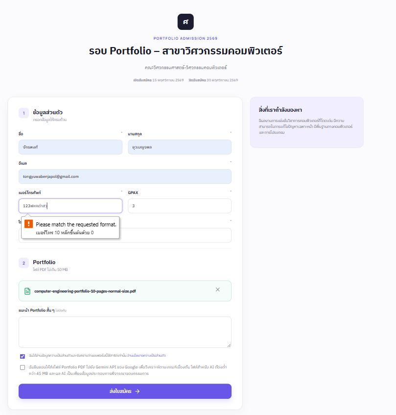

### Issue และความรุนแรง

[ไม่มี / รายละเอียด]

## TC-06 ช่วงค่า GPAX

| รายการ | บันทึก |
|---|---|
| ผล | Pass |
| วันที่และเวลา | 01/11/2026 เวลา [18:21] |
| ผู้ทดสอบ | ตง |
| Branch / Commit | `kan/backend` / `aa8c72765bf9e303bc92428416e0757a59fc5753` |
| Browser / Version | Google Chrome / 156.0.8078.48 (Official Build) (64-bit) |
| Viewport | 1766 × 1205 CSS px (desktop) |
| หน้าที่ทดสอบ | ฟอร์มสมัครจาก TC-01 |
| PDF ทดสอบ | [computer-engineering-portfolio-10-pages-normal-size.pdf] |

### ข้อมูลทดสอบ

- ทดลอง GPAX `4.5` และค่าติดลบแยกกัน; ช่องอื่นถูกต้อง

### ขั้นตอนทำซ้ำ

1. กรอกข้อมูลและแนบ PDF
2. ใส่ `4.5` แล้วกดส่ง
3. เปลี่ยนเป็นค่าติดลบแล้วกดส่ง
4. ตรวจ `/applications`

### ผลที่คาดหวัง

ทั้งสองค่าถูกปฏิเสธและไม่มีผู้สมัครใหม่

### ผลที่พบจริง

กรณีที่ใส่ค่า GPAX เกิน 4 (4.5) จะมีการแจ้งเตือนว่าค่าต้องมีน้อยกว่าหรือเท่ากับ 4
กรณีที่ใส่ค่า GPAX ติดลบ (-4.5) จะมีการแจ้งเตือนว่าค่ามากกว่าหรือเท่ากับ 0
ทั้งสองกรณ๊ระบบจะไม่อนุมัติให้ผู้สมัครส่งใบสมัครได้แม้จะมีการกรอกข้อมูลช่องอื่นครบ มีการแนบ PDF file และมีการยินยอมการให้ข้อมูล

### หลักฐาน

- Screenshots ใส่ค่า GPAX 4.5 :
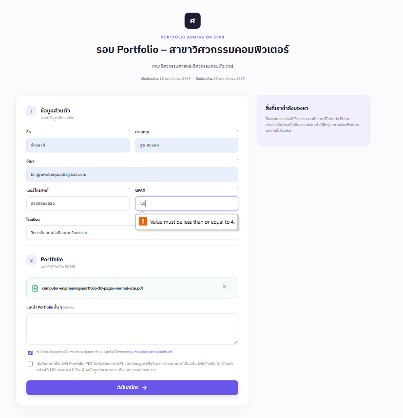

- Screenshots ใส่ค่า GPAX -4.5 :
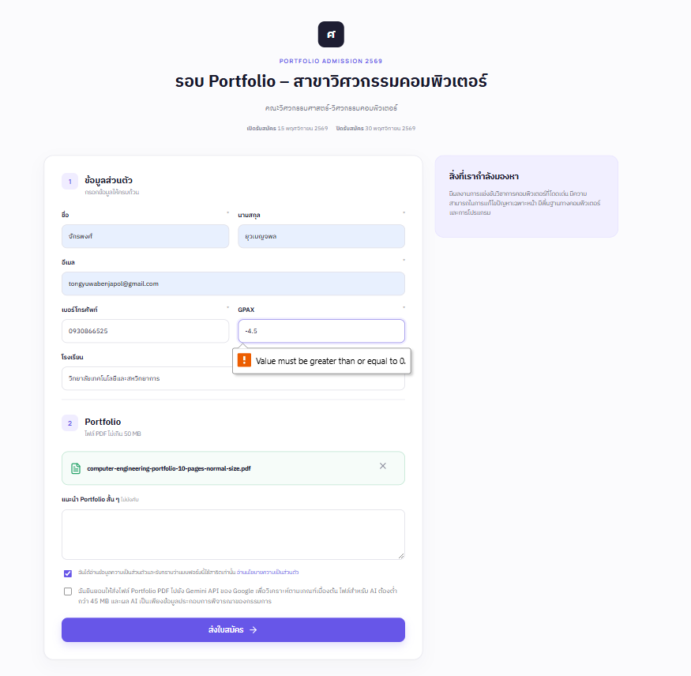

### Issue และความรุนแรง

[ไม่มี / รายละเอียด]

## TC-07 ไฟล์ที่ไม่ใช่ PDF

| รายการ | บันทึก |
|---|---|
| ผล | Pass |
| วันที่และเวลา | 01/11/2026 เวลา [18:27] |
| ผู้ทดสอบ | ตง |
| Branch / Commit | `kan/backend` / `aa8c72765bf9e303bc92428416e0757a59fc5753` |
| Browser / Version | Google Chrome / 156.0.8078.48 (Official Build) (64-bit) |
| Viewport | 1766 × 1205 CSS px (desktop) |
| หน้าที่ทดสอบ | ฟอร์มสมัครจาก TC-01 |
| PDF ทดสอบ | [A1-1.png] |

### ข้อมูลทดสอบ

- ใช้ฟอร์มจาก TC-01 และไฟล์ JPG หรือ TXT แทน PDF

### ขั้นตอนทำซ้ำ

1. กรอกข้อมูลถูกต้อง
2. ลองเลือกไฟล์ JPG , PNG หรือ TXT
3. เลือกการยินยอมหลักและกดส่ง
4. ตรวจ `/applications`

### ผลที่คาดหวัง

ไฟล์ผิดชนิดถูกปฏิเสธและไม่มีผู้สมัครใหม่

### ผลที่พบจริง

หลังจากเลือกไฟล์ที่ไม่ใช่ PDF แล้วทำการอัปโหลด จะไม่สามารถอัปโหลดไฟล์ที่ไม่ใช่ PDF ได้และมีข้อความแจ้งเตือน

### หลักฐาน

- Screenshots เลือกไฟล์ PNG :
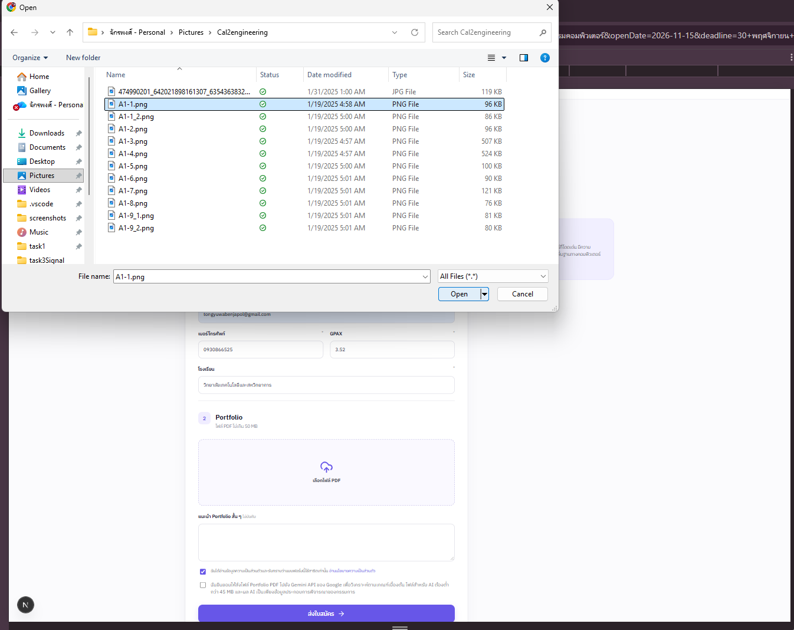
- Screenshots แสดงผลลัพธ์ :
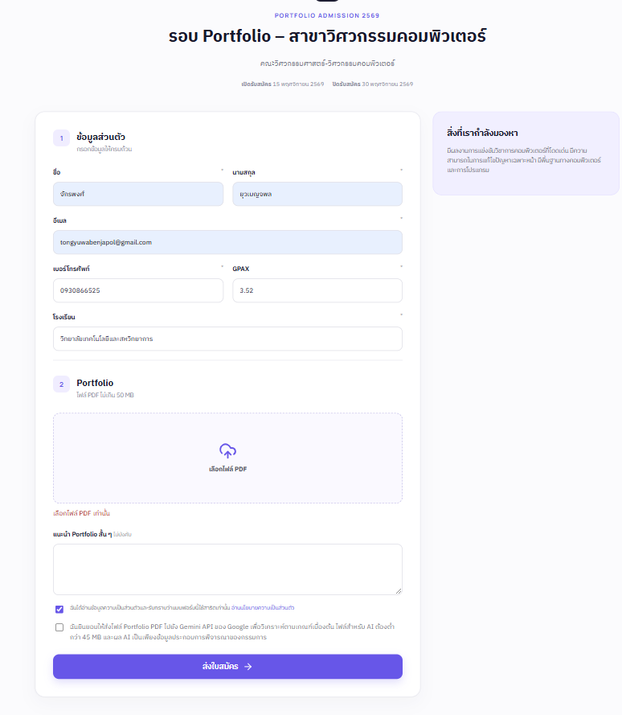

### Issue และความรุนแรง

[ไม่มี / รายละเอียด]

## TC-08 PDF เกิน 50 MB

| รายการ | บันทึก |
|---|---|
| ผล | Pass |
| วันที่และเวลา | 01/11/2026 เวลา [18:33] |
| ผู้ทดสอบ | ตง |
| Branch / Commit | `kan/backend` / `aa8c72765bf9e303bc92428416e0757a59fc5753` |
| Browser / Version | Google Chrome / 156.0.8078.48 (Official Build) (64-bit) |
| Viewport | 1766 × 1205 CSS px (desktop) |
| หน้าที่ทดสอบ | ฟอร์มสมัครจาก TC-01 |
| PDF ทดสอบ | [computer-engineering-portfolio-sample-over-50mb.pdf] ขนาด 58.3 MB |

### ข้อมูลทดสอบ

- ใช้ฟอร์มจาก TC-01 และ PDF ที่มีขนาดเกิน 50 MB

### ขั้นตอนทำซ้ำ

1. กรอกข้อมูลถูกต้อง
2. เลือก PDF ที่มีขนาดเกิน 50 MB
3. เลือกการยินยอมหลักและกดส่ง
4. ตรวจ `/applications`

### ผลที่คาดหวัง

ระบบปฏิเสธไฟล์ใหญ่เกินและไม่มีผู้สมัครใหม่

### ผลที่พบจริง

เมื่ออัปโหลดไฟล์ PDF ขนาดเกิน 50 MB จะไม่สามารถอัปโหลดไฟล์ได้และมีการแจ้งเตือนให้เลือกไฟล์ PDF ขนาดไม่เกิน 50 MB

### หลักฐาน

- Screenshots อัปโหลดไฟล์ PDF ขนาดเกิน 50 MB : 
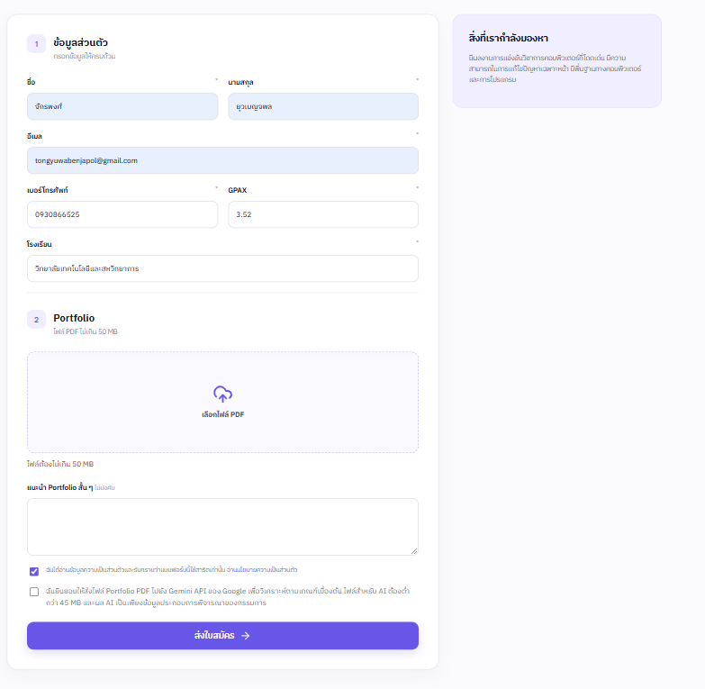

### Issue และความรุนแรง

[ไม่มี / รายละเอียด]

## TC-09 ส่งใบสมัครโดยไม่ยินยอม AI

| รายการ | บันทึก |
|---|---|
| ผล | Pass |
| วันที่และเวลา | 01/11/2026 เวลา [18:41] |
| ผู้ทดสอบ | ตง |
| Branch / Commit | `kan/backend` / `aa8c72765bf9e303bc92428416e0757a59fc5753` |
| Browser / Version | Google Chrome / 156.0.8078.48 (Official Build) (64-bit) |
| Viewport | 1766 × 1205 CSS px (desktop) |
| หน้าที่ทดสอบ | ฟอร์มจากลิงก์ TC-01, หน้าสำเร็จ, `/applications`, หน้ารายละเอียด |
| PDF ทดสอบ | computer-engineering-portfolio-10-pages-normal-size.pdf |

### ข้อมูลทดสอบ

- ผู้สมัครใหม่ [จักรพงศ์ ยุวเบญจพล]; ติ๊กยินยอมหลัก แต่ไม่ติ๊กยินยอม AI

### ขั้นตอนทำซ้ำ

1. กรอกข้อมูลครบ
2. แนบ PDF
3. เลือกยินยอมหลักเท่านั้น
4. ส่งใบสมัคร
5. จดเลขอ้างอิง
6. เปิดรายชื่อและรายละเอียด

### ผลที่คาดหวัง

ใบสมัครบันทึกสำเร็จ มีเลขอ้างอิงและรายชื่อใหม่ โดยไม่แสดงผลวิเคราะห์ AI

### ผลที่พบจริง

หลังจากกรอกข้อมูลผู้สมัครครบถ้วนและอัปโหลดไฟล์ PDF ทั้งให้การยินยอมการให้ข้อมูลส่วนแต่ไม่ได้แสดงผลวิเคราะห์ AI สามารถบันทึกใบสมัครสำเร็จ เลขอ้างอิงคือ demo-1793533726792 หลังจากนั้นพบว่ามีรายชื่อผู้สมัครใหม่คือ จักรพงศ์ ยุวเบญจพล ตรงกับใบสมัครที่บันทึกไป รายละเอียดบอกว่าไม่มีคะแนนและการประเมินจาก AI ตรงกับเงื่อนไขที่ผู้สมัครได้เลือกไว้

### หลักฐาน

-Screenshots อัปโหลดสำเร็จ(ไม่ใช้ AI วิเคราะห์) :
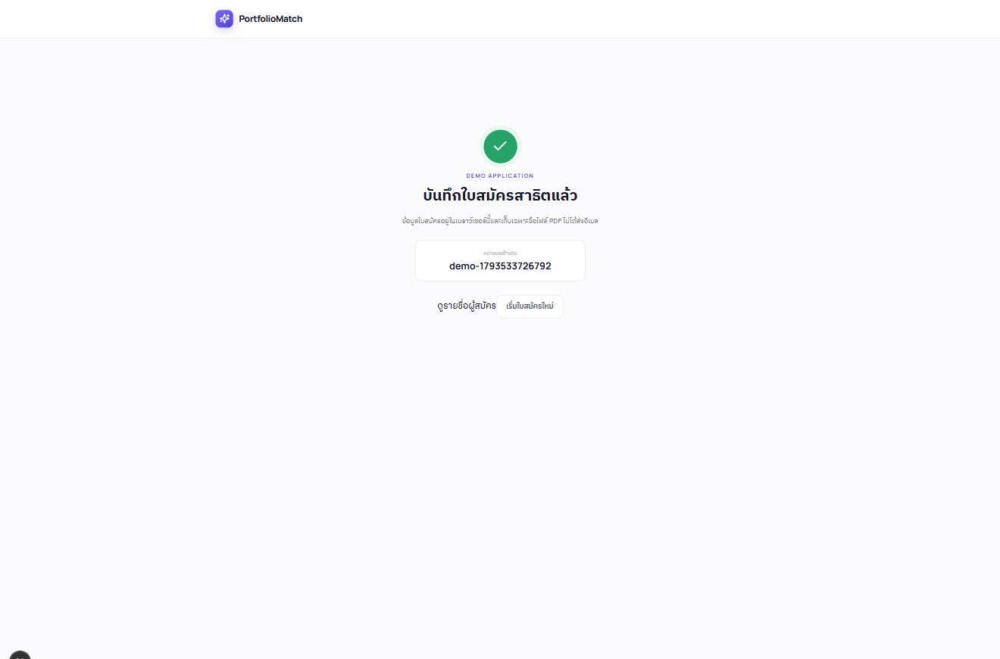

-Screenshots รายละเอียดจากหน้า Applicant :
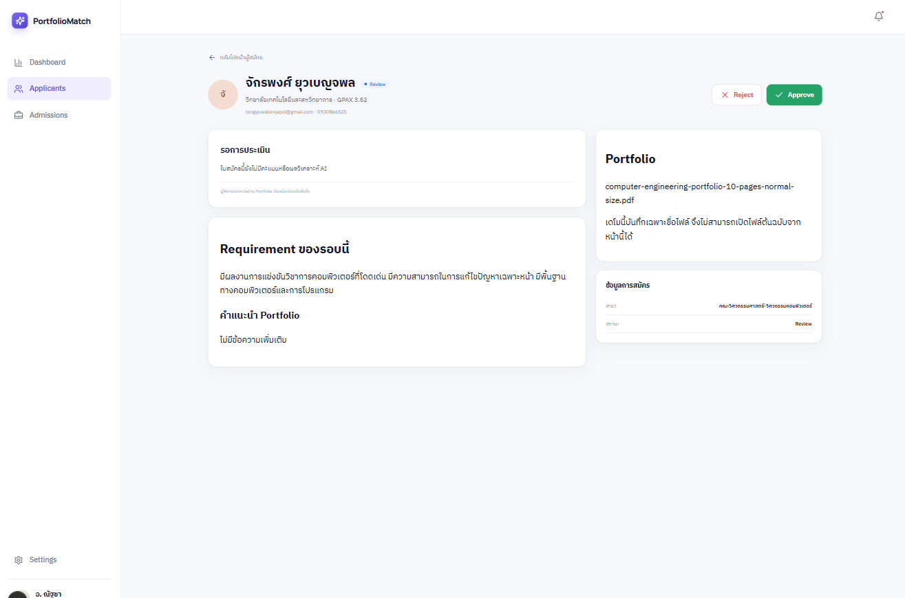

### Issue และความรุนแรง

[ไม่มี / รายละเอียด]

## TC-10 ส่งใบสมัครและวิเคราะห์ด้วย Gemini

| รายการ | บันทึก |
|---|---|
| ผล | Pass |
| วันที่และเวลา | 01/11/2026 เวลา [18:54] |
| ผู้ทดสอบ | ตง |
| Branch / Commit | `kan/backend` / `aa8c72765bf9e303bc92428416e0757a59fc5753` |
| Browser / Version | Google Chrome / 156.0.8078.48 (Official Build) (64-bit) |
| Viewport | 1766 × 1205 CSS px (desktop) |
| หน้าที่ทดสอบ | ฟอร์มจากลิงก์ TC-01, หน้าสำเร็จ, หน้ารายละเอียด |
| PDF ทดสอบ | [Portfolio_Ai_Jaidee_Computer_Engineering.pdf] ขนาด 76.7 KB|

### ข้อมูลทดสอบ

- ผู้สมัครใหม่ [เออาย ใจดี] สมัครรอบเดียวกับ TC-01; PDF จำลองไม่มีข้อมูลส่วนบุคคลจริง; ยินยอมหลักและยินยอม AI

### ขั้นตอนทำซ้ำ

1. กรอกข้อมูลครบและแนบ PDF
2. ติ๊กยินยอมทั้งสองช่อง
3. ส่งใบสมัคร
4. รอจนการวิเคราะห์เสร็จโดยไม่รีเฟรชระหว่างทาง
5. เปิดหน้ารายละเอียด

### ผลที่คาดหวัง

สมัครสำเร็จ มีคะแนน สรุป หลักฐานตาม requirement จุดแข็ง และข้อมูลที่ยังขาด โดย AI ไม่เปลี่ยนสถานะพิจารณาเอง

### ผลที่พบจริง

สามารถบันทึกใบสมัครและสร้างเลขอ้างอิงของผู้สมัครใหม่ นางสาว เออาย ใจดี เลขอ้างอิง demo-1793534869446 และมีการวิเคราะห์เบื้องต้นจาก AI โดยสามารถดูรายละเอียดการวิเคราะห์คะแนนและสิ่งที่ยังขาดอ้างอิงจาก requirement ของรอบสมัครนั้นๆได้จากหน้า Applicant 
-รายละเอียดจากการวิเคราะห์ด้วย AI : 
1.พบพื้นฐาน Python และโครงงานบันทึกรายรับรายจ่าย
2.พบตัวอย่างการแก้ปัญหาข้อมูลนำเข้าผิดรูปแบบ
3.ระบุว่าขาดประสบการณ์แข่งขันและไม่มีรางวัลการแข่งขัน
4.ไม่แต่งชื่อการแข่งขัน รางวัล หรือผลงานที่ไม่มีใน PDF
5.แสดงคะแนน สรุป หลักฐานตามเกณฑ์ จุดแข็ง ข้อมูลที่ขาด และ ข้อจำกัดของการประเมิน
6.สถานะผู้สมัครไม่เปลี่ยนเป็น Approved/Rejected อัตโนมัติ
### หลักฐาน
-Screenshots ข้อมูลผู้สมัคร :
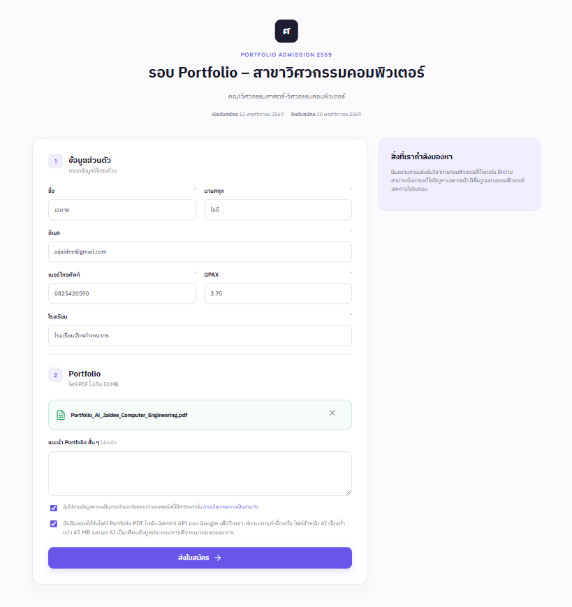
- Screenshots บันทึกใบสมัครสำเร็จ :
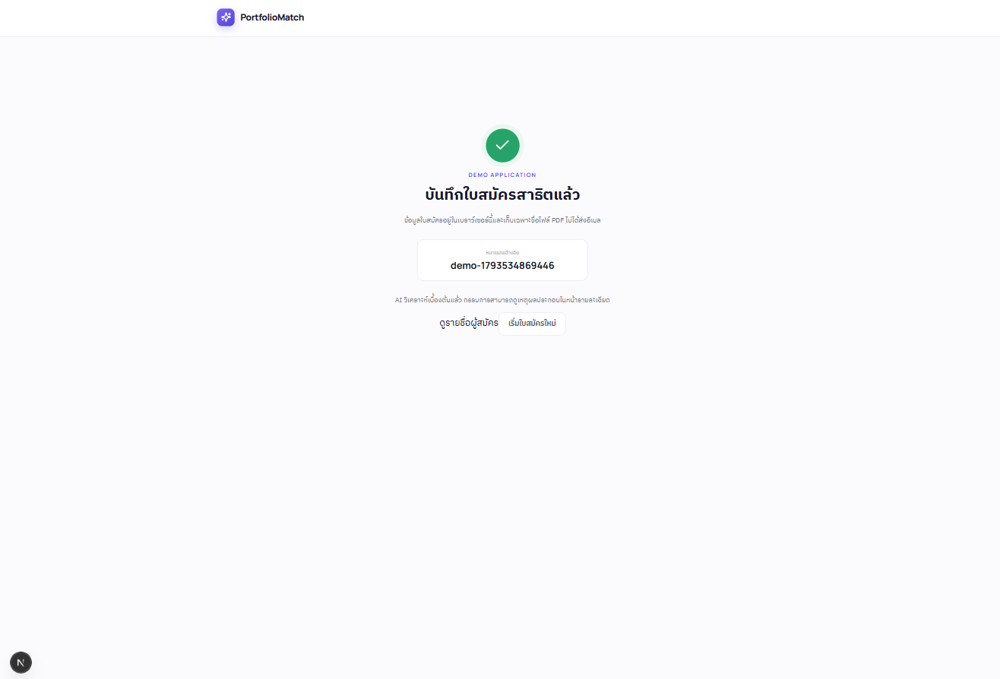
- Screenshots รายละเอียดผู้สมัครจากหน้า Applicant :

### Issue และความรุนแรง

[ไม่มี / รายละเอียด; ถ้า AI ล้มเหลวให้บันทึกว่าใบสมัครยังอยู่หรือไม่]

## TC-11 รีเฟรชหลังการวิเคราะห์เสร็จ

| รายการ | บันทึก |
|---|---|
| ผล | Pass |
| วันที่และเวลา | 01/11/2026 เวลา [19:26] |
| ผู้ทดสอบ | ตง |
| Branch / Commit | `kan/backend` / `aa8c72765bf9e303bc92428416e0757a59fc5753` |
| Browser / Version | Google Chrome / 156.0.8078.48 (Official Build) (64-bit) |
| Viewport | 1766 × 1205 CSS px (desktop) |
| หน้าที่ทดสอบ | หน้าสำเร็จและหน้ารายละเอียดของ TC-10 |
| PDF ทดสอบ | [Portfolio_Ai_Jaidee_Computer_Engineering.pdf] ขนาด 76.7 KB |

### ข้อมูลทดสอบ

- ใช้ใบสมัครและผล AI ที่วิเคราะห์เสร็จจาก TC-10

### ขั้นตอนทำซ้ำ

1. หลัง TC-10 วิเคราะห์เสร็จ จดเลขอ้างอิง สถานะ และผล AI
2. รีเฟรชหน้าสำเร็จ
3. เปิดหน้ารายละเอียดแล้วรีเฟรช
4. เทียบข้อมูลก่อนและหลัง

### ผลที่คาดหวัง

เลขอ้างอิง สถานะ และผล AI ที่เสร็จแล้วคงอยู่

### ผลที่พบจริง

เลขอ้างอิงก่อนทำการรีเฟรชหน้าจอของใบสมัคร demo-1793534869446 
เลขอ้างอิงหลังทำการรีเฟรชหน้าจอของใบสมัคร demo-1793534869446 

ผลการวิเคราะห์ของ AI ทั้งก่อนและหลังรีเฟรชพบว่ามีคะแนนเท่ากันและมีเกณฑ์การประเมิน จุดเด่นและสิ่งที่ขาดเหมือนเดิม

### หลักฐาน

- Screenshots รีเฟรชหน้าที่บันทึกใบสมัครสำเร็จ
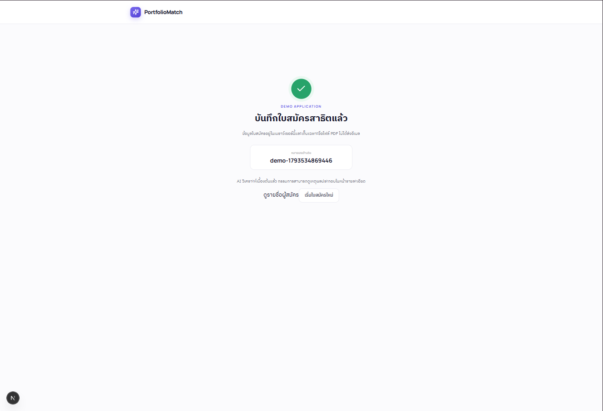

- Screenshots รีเฟรชหน้าที่รายละเอียดผู้สมัครนางสาวเออาย : 
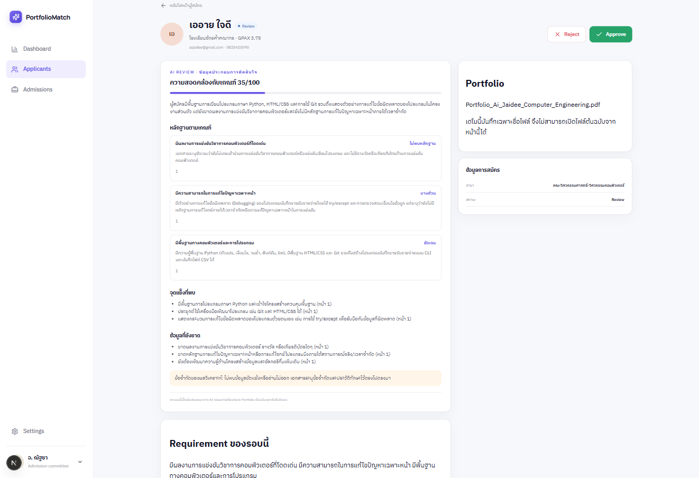

### Issue และความรุนแรง

[ไม่มี / รายละเอียด]

## TC-12 Approve และ Reject ผู้สมัครคนละราย

| รายการ | บันทึก |
|---|---|
| ผล | Pass |
| วันที่และเวลา | 01/11/2026 เวลา [19:30] |
| ผู้ทดสอบ | ตง |
| Branch / Commit | `kan/backend` / `aa8c72765bf9e303bc92428416e0757a59fc5753` |
| Browser / Version | Google Chrome / 156.0.8078.48 (Official Build) (64-bit) |
| Viewport | 1766 × 1205 CSS px (desktop) |
| หน้าที่ทดสอบ | `/applications`, หน้ารายละเอียด, `/dashboard` |
| PDF ทดสอบ | N/A |

### ข้อมูลทดสอบ

- ผู้สมัคร A [จักรพงศ์ ยุวเบญจพล ,เลขอ้างอิง : demo-1793533726792 ] และ B [เออาย ใจดี ,เลขอ้างอิง :demo-1793534869446 ] ที่ส่งผ่านฟอร์ม TC-01; A สำหรับ Approve และ B สำหรับ Reject

### ขั้นตอนทำซ้ำ

1. จดยอดและสถานะก่อนทำ
2. Approve ผู้สมัคร A
3. Reject ผู้สมัคร B
4. รีเฟรชหน้ารายละเอียดทั้งสอง
5. รีเฟรช `/applications` และ `/dashboard`
6. เทียบสถานะและยอดรวม

### ผลที่คาดหวัง

A แสดง Approved, B แสดง Rejected ทุกหน้าและหลังรีเฟรช; ยอดรวมตรงกับรายชื่อจริง

### ผลที่พบจริง
ก่อนอัปเดต : 
-หน้าของ Dashboard ก่อนอัปเดตสถานะของผู้สมัคร A และ B มีจำนวนผู้สมัคร 6 คน สถานะผู้สมัคร A และ B เป็น reviewed 
-หน้าของ Applicant ก่อนอัปเดตสถานะของผู้สมัคร A และ B มีรายการผู้สมัคร 6 คน ทุกคนมีสถานะ reviewed ผู้สมัคร A ไม่มีการประเมินจาก AI , ผู้สมัคร B มีคะแนนการประเมินจาก AI 35 คะแนน และมีข้อมูลจากการวิเคราหะ์

หลังอัปเดต :
-ทั้งหน้าของ Dashboard และ Applicant มีการแสดงสถานะของผู้สมัคร A และ B ตรงกับที่กำหนดไว้คือ A ไดัรับการ Approved , B ได้รับการ Rejected และหลังการทดสอบ refresh ทั้งสองหน้าพบว่าสถานะของผู้สมัครยังคงเดิมเหมือนที่ได้อัปเดต

### หลักฐาน

- Screenshots ผู้สมัคร A ได้รับการ Approved :
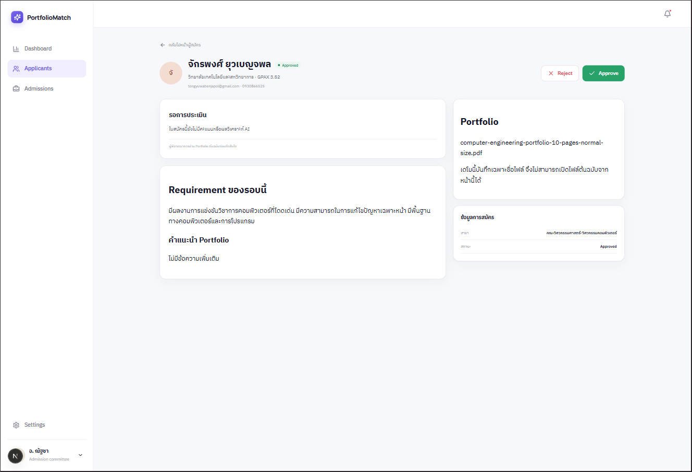
- Screenshots ผู้สมัคร B ได้รับการ Rejected :
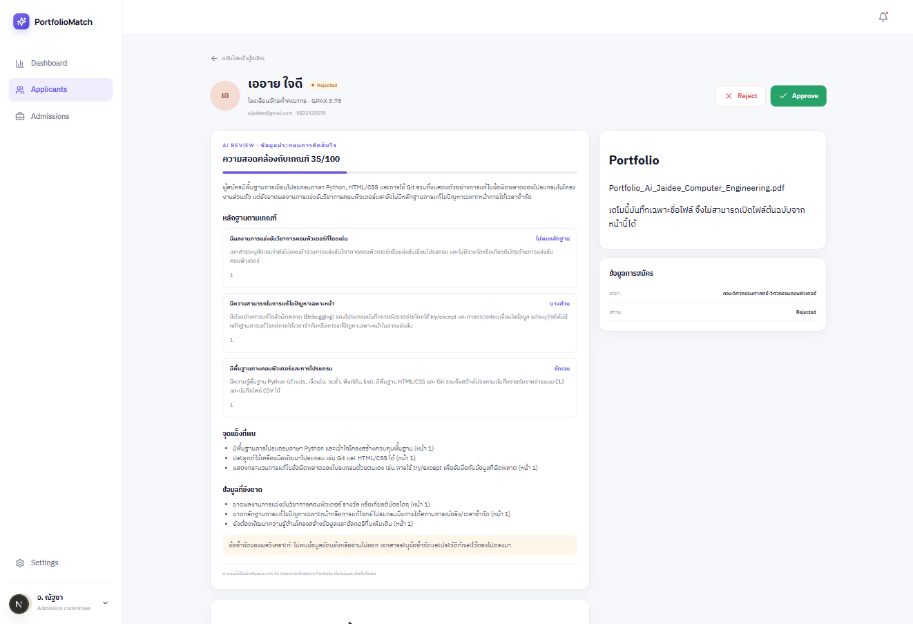
- Screenshots สถานะของผู้สมัครหน้า Application : 
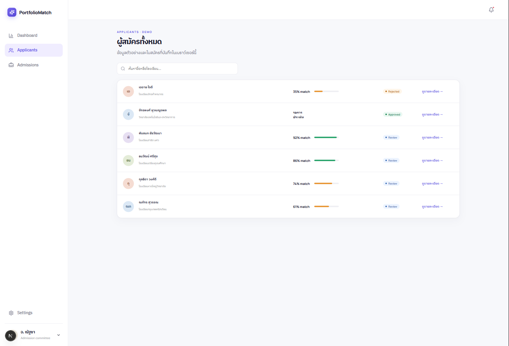
- Screenshots สถานะของผู้สมัครหน้า Dashboard :
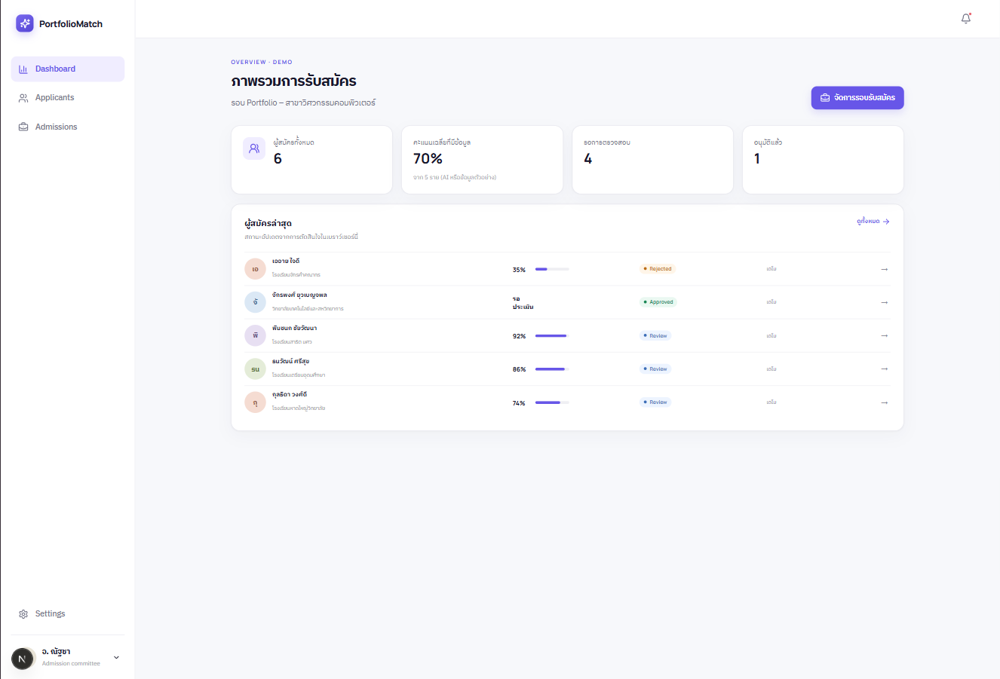

### Issue และความรุนแรง

[ไม่มี / รายละเอียด]

## TC-13 ตรวจทุกหน้าบนเดสก์ท็อป

| รายการ | บันทึก |
|---|---|
| ผล | Pass |
| วันที่และเวลา | 01/11/2026 เวลา [19:44] |
| ผู้ทดสอบ | ตง |
| Branch / Commit | `kan/backend` / `aa8c72765bf9e303bc92428416e0757a59fc5753` |
| Browser / Version | Google Chrome / 156.0.8078.48 (Official Build) (64-bit) |
| Viewport | 1766 × 1205 CSS px (desktop) |
| หน้าที่ทดสอบ | `/create`, ฟอร์มจากลิงก์ TC-01, หน้าสำเร็จ, `/applications`, หน้ารายละเอียด, `/dashboard`, `/privacy` |
| PDF ทดสอบ | N/A |

### ข้อมูลทดสอบ

- ตรวจทุกหน้าบน viewport เดสก์ท็อป 1766 × 1205 CSS px รวมฟอร์มจาก TC-01

### ขั้นตอนทำซ้ำ

1. ใช้ viewport เดสก์ท็อปตามตารางของ TC-13
2. เปิดทุกหน้าที่ระบุ
3. เลื่อนแต่ละหน้าจากบนสุดถึงล่างสุด
4. ทดลองปุ่มและลิงก์สำคัญ
5. ตรวจข้อความ การจัดวาง และป้ายสถานะ

### ผลที่คาดหวัง

เนื้อหาไม่ล้นหรือทับกัน ปุ่มและลิงก์ใช้งานได้ และป้ายสถานะอ่านได้ครบ

### ผลที่พบจริง

จากการตรวจสอบทุกหน้าไม่พบความผิดปกติใด ปุ่มการทำงานปกติ ข้อความแสดงผลปกติไม่มีเนื้อหาล้น สถานะของผู้สมัครอ่านได้ครบถ้วน

### Issue และความรุนแรง

[ไม่มี / รายละเอียด]

## TC-14 ตรวจข้อความและการแสดงผลปุ่มบน viewport 390 × 844

| รายการ | บันทึก |
|---|---|
| ผล | Pass |
| วันที่และเวลา | 01/11/2026 เวลา [กรอกเวลา หากทดสอบวันอื่นให้แก้วันที่ตามจริง] |
| ผู้ทดสอบ | ตง |
| Branch / Commit | `kan/backend` / `aa8c72765bf9e303bc92428416e0757a59fc5753` |
| Browser / Version | Google Chrome / 156.0.8078.48 (Official Build) (64-bit) |
| Viewport | 390 × 844 CSS px (Chrome Responsive mode) |
| หน้าที่ทดสอบ | `/create`, ฟอร์มจากลิงก์ TC-01, หน้าสำเร็จ, `/applications`, หน้ารายละเอียดผู้สมัคร, `/dashboard`, `/privacy` |
| PDF ทดสอบ | N/A |

### ข้อมูลทดสอบ

- ใช้ลิงก์สมัครและข้อมูลรอบรับสมัครจาก TC-01 ใน Chrome โปรไฟล์เดิม
- ใช้ข้อมูลและใบสมัครที่มีอยู่จากการทดสอบก่อนหน้าเพื่อเปิดตรวจหน้าต่าง ๆ

### ขั้นตอนทำซ้ำ

1. เปิด Chrome แล้วกด `F12` และ `Ctrl+Shift+M` เลือก Responsive ตั้งขนาดเป็น `390 × 844`
2. เปิดแต่ละหน้าที่ระบุในตาราง และเลื่อนตั้งแต่บนสุดจนสุดหน้า
3. ตรวจข้อความ หัวข้อ และข้อความในช่องกรอกว่าไม่ล้นกรอบ ไม่ทับกัน และไม่ถูกตัดจนอ่านไม่ได้
4. ตรวจปุ่มว่ามองเห็นครบ ข้อความบนปุ่มอ่านได้ และปุ่มไม่ซ้อนกันหรือถูกองค์ประกอบอื่นบัง
5. ตรวจการจัดวางโดยรวมว่าอยู่ในขอบจอและไม่มีเนื้อหาล้นแนวนอน
6. บันทึกผลแยกรายหน้า และถ่ายภาพบริเวณที่ตรวจหรือพบปัญหา

### ผลที่คาดหวัง

- ข้อความแสดงครบ อ่านได้ ไม่ล้นกรอบหรือทับกันที่ 390 × 844
- ปุ่มแสดงครบ ข้อความบนปุ่มอ่านได้ ไม่ถูกตัด ซ้อนกัน หรือบัง
- การจัดวางอยู่ในขอบจอและไม่มีเนื้อหาล้นแนวนอน

### ผลที่พบจริง

ใช้การทดสอบแบบเดียวกันกับ viewport : 1766 x 1205 ไม่พบความผิดปกติใดๆ ข้อความแสดงเนื้อหาได้ปกติ ปุ่มการทำงานใช้งานได้ปกติสามารถ navigate และทำงานเหมือนหน้าจอ desktop ส่วนที่ได้แก้ไขเพิ่มพบว่า สามารถแสดงข้อมูลรายการผู้สมัครได้ครบถ้วน สามารถแสดงอัตราการเข้าเกณฑ์ คะแนนที่ได้จากการวิเคราะห์ สถานะการ reviewed / Approved / Rejected แสดงครบถ้วนโดยไม่จำเป็นต้อง scrolled ในแนวนอน ทั้งการแสดงผลข้อมูลผู้สมัครของหน้า Applicant และ Dashboard แสดงผลได้ตรงกันครบถ้วน

### หลักฐาน

ไม่มีรูปภาพเนื่องจากไม่พบความผิดปกติ

### Issue และความรุนแรง

[ไม่มี / ระบุหน้าที่พบปัญหา ขั้นตอนทำซ้ำ ผลที่พบ และระดับความรุนแรง]
